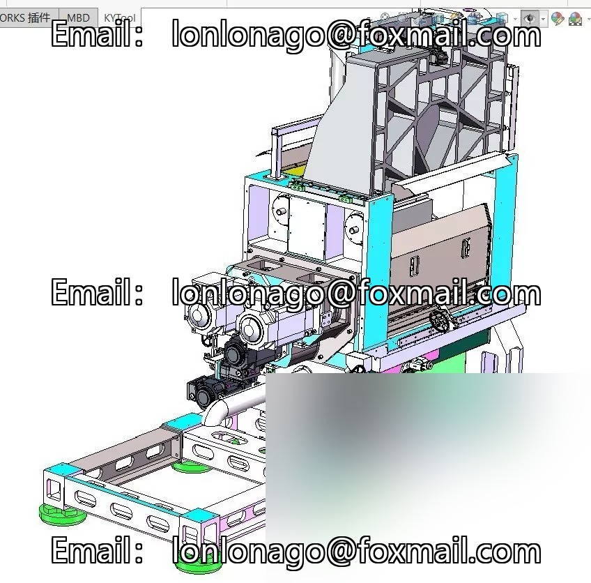
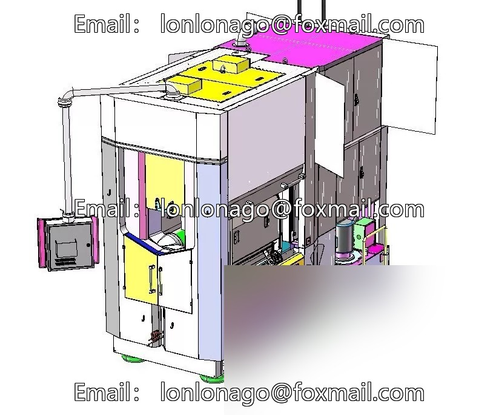

# Semiconductor silicon wafer slicer STP drawing set

## Body

Semiconductor wafer slicer STP drawing package: semiconductor wafer slicer main machine drawings, STP format, over 2,000 parts! Along with relevant reference materials!
The slicer cuts very thin silicon wafers after square-forming. The thickness of silicon wafers is mostly around 200um. Multi-lathe cutting equipment is mainly for cutting and processing hard and brittle materials, typical applications include single crystal multi crystal slicing, blue sapphire, magnetic materials, optical glass processing, etc.
This is a very referenceable piece of equipment!!!
sold are non-returnable!

The package includes STP drawing for semiconductor silicon wafer slicer, the whole-machine drawings and STP format, along with related references; the slicer cuts a squared crystal rod into thin silicon wafers for hard brittle materials and is used in solar, sapphire, magnetic materials and optical glass processing.

<!-- AI_ENRICHED -->

## Images

## Payment

Here is a pay link on Stripe ( https://buy.stripe.com/3cs8yP7sY87d0vu9AB ). Please contact me lonlonago@foxmail.com after funding $89, and I will send you a complete data files , thank you!

